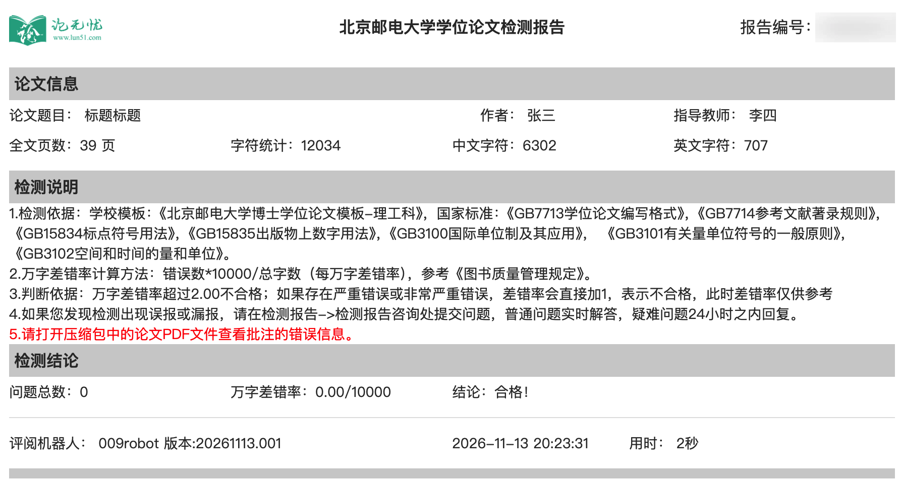

# 北京邮电大学研究生学位论文 LaTeX 模板

本项目是北京邮电大学研究生学位论文的 LaTeX 模板，面向理工科硕士和博士研究生。官方 Word 模板的全部版式已复刻为 `buptthesis` 文档类，作者只需填写扉页信息并撰写内容，用 XeLaTeX 编译即可得到符合学校格式要求的论文。

## 一、遵循标准

版式依据研究生院发布的两份文件制作。

- [北京邮电大学研究生学位论文写作与制作规范（2025年1月15日）.doc](./materials/北京邮电大学研究生学位论文写作与制作规范（2025年1月15日）.doc)，研究生院发布的写作与制作规范
- [北京邮电大学研究生学位论文模板-理工科（2025年1月15日）.doc](./materials/北京邮电大学研究生学位论文模板-理工科（2025年1月15日）.doc)，官方 Word 模板，版式逐项对照复刻

经过验证，本项目生成的 [main.pdf](./main.pdf) 与 Microsoft Word 渲染 [基准.doc](./materials/基准.doc) 得到的 [基准.pdf](./materials/基准.pdf) 基本一致，并通过学校官网推荐的论无忧格式检测。



## 二、适用范围

模板覆盖北京邮电大学理工科硕士与博士学位论文。在 `main.tex` 的 `\documentclass` 中设置以下选项。

| 选项 | 含义 | 默认值 |
| --- | --- | --- |
| `master` / `phd` | 硕士学位 / 博士学位 | `phd` |
| `phil` / `eng` | 学术学位 / 专业学位 | `phil` |
| `print` / `electronic` | 打印版 / 电子版 | `print` |
| `blind` | 盲审版，扉页作者、学号和导师匿名，答辩委员会名单置空，自动排除致谢 | 关闭 |

文科等学科的官方模板版式不同，本模板未适配。

## 三、文件结构

```text
BUPT-Thesis-Template/
├── main.tex                            # 主文件，文档类选项、扉页信息与全文结构
├── main.bib                            # 参考文献数据库，正文以 \cite 引用
├── main.pdf                            # 当前示例配置编译出的完整论文
├── .latexmkrc                          # latexmk 编译配置
├── .gitignore                          # 忽略编译中间产物
├── .vscode/settings.json               # LaTeX Workshop 构建按钮固定为 XeLaTeX
├── chapters/                           # 前置与后置部分
│   ├── cnabstract.tex                  # 中文摘要
│   ├── enabstract.tex                  # 英文摘要
│   ├── nomenclature.tex                # 符号表
│   ├── appendix.tex                    # 附录
│   ├── acknowledgement.tex             # 致谢，盲审模式自动排除
│   ├── publication.tex                 # 攻读学位期间取得的创新成果
│   ├── experience.tex                  # 作者学习经历
│   └── main/                           # 正文各章
│       ├── chapter_01.tex              # 第一章 绪论
│       ├── chapter_02.tex              # 第二章 标题示例
│       ├── chapter_03.tex              # 第三章 标题示例
│       ├── chapter_04.tex              # 第四章 标题示例
│       └── chapter_05.tex              # 第五章 结论
├── algorithms/                         # 算法，按章分文件夹存放
│   └── chapter_01/algorithm_01.tex     # 算法环境示例
├── tables/                             # 表格，按章分文件夹存放
│   ├── chapter_01/table_01.tex         # 三线表与表注示例
│   └── chapter_01/table_02.tex         # 跨页长表与续表表头示例
├── figures/                            # 插图，按章分文件夹存放
│   ├── chapter_01/figure_01.png        # 单图示例
│   ├── chapter_01/figure_02_a.png      # 分图示例
│   └── chapter_01/figure_02_b.png
├── templates/                          # 格式相关文件
│   ├── buptthesis.cls                  # 北邮学位论文文档类
│   ├── buptthesis.cfg                  # 模板固定文案与资源路径，由文档类自动读取
│   ├── gbt7714.sty                     # GB/T 7714 参考文献宏包
│   ├── gbt7714-numerical.bst           # GB/T 7714 顺序编码制样式
│   └── assets/                         # 封面与字体资源
│       ├── gbkai-Regular.ttf           # 国标楷体，用于题注
│       ├── logo.png                    # 校徽
│       └── name.png                    # 中文封面校名
└── materials/                          # 标准依据与验证材料，写作时不涉及
    ├── 北京邮电大学研究生学位论文写作与制作规范（2025年1月15日）.doc
    ├── 北京邮电大学研究生学位论文模板-理工科（2025年1月15日）.doc
    ├── 基准.doc                        # Microsoft Word 基准文档
    ├── 基准.pdf                        # 基准文档经 Word 渲染的结果
    └── report.png                      # 论无忧格式检测报告
```
